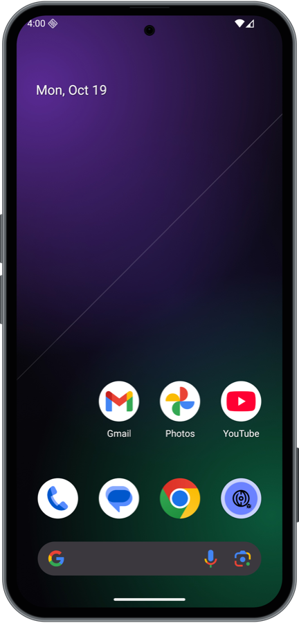

# The Seeker look: skin + theme

Added 2026-10-19. Everything here is **our own drawing**, made to scale from public measurements. No Solana Mobile photos, renders or logos are included (decision D6).



## 1. Skin (the phone frame around the emulator screen)
Files: [profiles/seeker/skin/](../profiles/seeker/skin/)
| File | What |
|---|---|
| `make-skin.swift` | draws `back.png` (phone body), `mask.png` (rounded screen corners + camera hole) and `layout` |
| `check-skin.swift` | **verifies symmetry**: measures metal + black bezel on all 4 sides and 4 corners |
| `make-preview.swift` | composites a device screenshot into the skin (for docs) |
| `make-wallpaper.swift` | draws the wallpaper (bundled into the SMS Test Wallet app) |

### Measurements used
| Item | Value | Source |
|---|---|---|
| Body | 73.5 × 154.8 × 9.3 mm | official spec, solanamobile.com/seeker |
| Display | 1200 × 2670 @ 460 ppi = 66.3 × 147.4 mm | official spec |
| Corner radius | 9.7 mm in the skin (the render measures ~10.8 mm, see "Square corners bug") | official front render (pixel scan) |
| Volume keys | **left** side, 53.1–65.3 mm and 68.3–80.5 mm from the top | measured from the official front render |
| Power / **Seed Vault fingerprint key** | **right** side, 111.3–129.9 mm from the top | official render (front) + back render (key next to the "Seed Vault" panel) |
| Front camera | small **centered punch hole** near the top | hands-on review photo (Decrypt) |
| Frame colors | cool slate metal: `#1F2425` lip, `#B5C4C7` chamfer highlight, `#516066` brushed, `#2D373A` mid, `#1B2123` inner lip | percentiles of frame/body pixels in the official back render |

Scale: 18.1 px/mm (1200 px = 66.3 mm). Skin: 1348 × 2808, body 1330 × 2800, display at (74, 69).

### Square corners bug (fixed 2026-10-19)
**Symptom:** in every app the status bar looked "off": square corners poked into the rounded screen, and a faint square outline showed at all 4 corners.
**Cause:** the emulator draws `back.png`, then the display **rectangle**, then `mask.png` on top. With an ~11 mm corner the metal curve reaches *inside* the display rectangle, so the display (and the mask's black corners) painted over the frame and left black square notches.
**Fixes:**
1. `mask.png` now repaints the phone body (frame + glass) in its corners, from the same drawing code as `back.png`.
2. Glass is pure `#000000`, the same as the mask, and runs 4 px *under* the display edge so smoothed edge pixels blend black-on-black.
3. The emulator scales the display layer and the frame layer by slightly different factors (e.g. 56.25% vs 55.98%; the `window.scale` setting is ignored), so metal drawn in both layers can never line up exactly. The corner radius is therefore **9.7 mm** with a 0.9 mm metal band: the glass curve clears the display-rectangle corner by 3 px (`(R − 65)·√2 ≤ R − rim − 3`), so the layers only meet black-on-black at any window size.
4. `make-preview.swift` now draws layers in the emulator's order (back → display → mask). The old order (back on top) hid this bug.

Verified live: all 4 corners on a white, scrolled Settings screen and in Fake dApp's dark status bar. No notches.

### Pixel-perfect symmetry (verified)
`swift profiles/seeker/skin/check-skin.swift profiles/seeker/skin/back.png`
```
top / bottom / left / right   metal 16  black 53   (black includes the 4 px underlap)
TL / TR / BL / BR diagonal    metal 13  black 37   (identical; concentric corners)
```
- The body height was set to `display + (bodyW − displayW)` (154.7 mm instead of 154.8), so every side is **exactly** the same width. The 0.1 mm difference is invisible, while a 1 px difference was visible.
- The frame shading is **symmetric**: concentric bands (dark lip → polished chamfer → brushed gray → inner lip), no directional light. The first version had a top-left light, which made the sides *look* different widths.

### Note about the live emulator window
The emulator shrinks the window to fit the screen, and it scales the frame and the screen by slightly different factors (e.g. 55.98% vs 56.25%). That can create 1–2 px of rounding in the live window. It's inside the emulator, not in the skin. At 100% the skin is exact.

### How it's applied
`sms setup` writes the skin (embedded in the `sms` binary) to `~/.sms/skins/seeker` and sets in the AVD `config.ini`: `skin.name=seeker`, `skin.path=…`, `skin.dynamic=no`, `showDeviceFrame=yes`.

## 2. Display overlay: camera hole, rounded corners, status bar
Source: [android/seeker-overlay/](../android/seeker-overlay/) (built by `build.sh` with aapt2/apksigner, no Gradle). Prebuilt copy: `profiles/seeker/overlay/SeekerDisplayOverlay.apk`, embedded in `sms`.

**Problem (user report):** the clock and icons sat too close to the rounded corners and too high. The stock emulator image doesn't know the screen has a camera hole or rounded corners.

**Fix:** a static system overlay on the `android` framework (what a phone maker ships), installed in `/product/overlay/` by `sms setup`:
| Resource | Value | Effect |
|---|---|---|
| `config_mainBuiltInDisplayCutout` | `M -24,67 A 24,24 0 1,0 24,67 A 24,24 0 1,0 -24,67 Z` | Android knows the centered camera hole (same place and size as the skin) |
| `status_bar_height(_default/_portrait)` | 134 px (= 2 × 67) | clock and icons are vertically centered on the camera, like a real Seeker |
| `rounded_corner_radius` / `_bottom` | 113 px | the real screen corner radius |
| `rounded_corner_radius_top` | 39 px | SystemUI pads the clock by the whole top radius (113 px pushed it ~184 px in). At status-bar height the curve only needs ~10 px, so 39 px was tuned by measuring until the clock sits as far from the left edge as the icons from the right |

Tuning steps (measured on screenshots): no overlay → clock at the very edge, too high · 113 px → 184 px in, too far · 12 px → 49 px · **39 px → ~82 px, matching the right side**. Approved by the user.

**Fake cutouts removed:** the emulator image ships test overlays (`/product/overlay/DisplayCutoutEmulation*`) that fake other phones' cutouts. One of them, a black punch hole on the *left*, switched itself back on after a reboot (user report: "black dot on the left"). Disabling wasn't enough, so `sms setup` now **deletes** them, and `sms doctor` fails the Display check if any are present. `sms doctor`: `✓ Display  camera-hole cutout + rounded corners`.

## 3. Theme (inside Android)
Measured from hands-on photos of a real Seeker (Decrypt review):
| Real Seeker | Measured | Virtual Seeker |
|---|---|---|
| Light mode (light search bar, light system screens) | — | `cmd uimode night no` |
| System colors generated from the wallpaper (Material You, stock Android 16) | — | `color_source: home_wallpaper`, TONAL_SPOT (the first try forced lavender `#7B6EC6`, which came from the Seed Vault Wallet app's own colors) |
| Home wallpaper, **color-corrected** against the photo's white point (`#C0B4E3` → white): top `#01223C` navy, near-black band behind the clock, middle `#252A3C` slate-navy, lower `#044558` deep teal-navy, bottom `#546D68` gray-teal | review photo | our own gradient in those colors (`make-wallpaper.swift`) |
| Back panel: blue-gray slate | review photo | matches the frame's cool slate tint |

Applied by `sms setup` ([theme.rs](../crates/sms-core/src/theme.rs)):
| What | How |
|---|---|
| Light mode | `cmd uimode night no` |
| System colors from the wallpaper | `settings put secure theme_customization_overlay_packages '{"android.theme.customization.color_source":"home_wallpaper","android.theme.customization.theme_style":"TONAL_SPOT"}'` |
| Wallpaper (home + lock) | Android has no shell command for it, so the SMS Test Wallet app has a `ThemeActivity` that sets the bundled wallpaper: `am start -W -n dev.sms.wallet/.ThemeActivity` |

`sms doctor` shows `✓ Theme  Seeker style (light, colors from the Seeker wallpaper)`

Still unknown: the exact stock Seeker wallpaper. No official download exists, and the only home-screen reference is one outdoor photo. A screenshot from a real Seeker would pin it exactly. and `✓ Virtual Seeker … Seeker skin`.

## 4. Home screen layout
Modeled on a real Seeker's home screen (hands-on photo). [home.rs](../crates/sms-core/src/home.rs) writes the Pixel launcher's `launcher_4_by_5.db` (`favorites` table: container `-100` = grid, `-101` = dock) as root, then restarts the launcher.

| Row | Real Seeker (photo) | Virtual Seeker |
|---|---|---|
| 1 | Bluesky · Camera · **dApp Store** · Instagram | Clock · Camera · **dApps** · Calendar |
| 2 | Maps · Apple Music · Photos · Play Store | Maps · YT Music · Photos · Settings |
| 3 | Pocket Casts · TikTok · YouTube · **Wallet** | Fake dApp · Contacts · YouTube · **Wallet** |
| Dock | Phone · Messages · Chrome · Gmail | Phone · Messages · Chrome · Gmail |

- **dApps** (our app, `DappsActivity`, own icon): sits in the dApp Store spot. The real dApp Store only runs on Solana Mobile devices, so it lists the apps you installed (e.g. `sms install your-app.apk`) and opens them.
- **Wallet** = the SMS Test Wallet with its own icon, in the Seed Vault Wallet spot.
- Apps that aren't installed are skipped. Existing widgets are kept.
- `sms doctor`: `✓ Home screen  Seeker layout (dApps, Wallet, dock)`.

Differences left: the real Seeker shows a big clock widget at the top (ours: the Pixel date line), and its search bar sits *above* the dock (the Pixel launcher puts it below; no setting for that).

## Not done yet
- Boot animation (needs a custom system image).
- The real Seeker's default wallpaper (ours is Seeker-style, not a copy).
